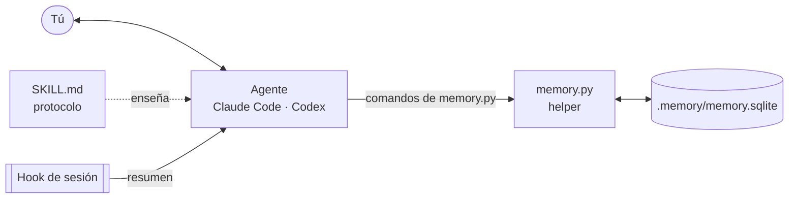

<div align="center">

# Long-Term Memory for AI

**Una memoria persistente, local y sólo de agregado para agentes de programación con IA.**

[](https://github.com/proteo5/long-term-memory-for-AI/actions/workflows/tests.yml)
[](LICENSE)
[](https://www.python.org/)
[](CHANGELOG.md)

[English](README.md) · **Español** · [Sitio web](https://proteo5.github.io/long-term-memory-for-AI/es/)

</div>

---

Long-Term Memory for AI les da a agentes como **Claude Code** y **Codex** una memoria que
sobrevive entre conversaciones. Vive en un solo archivo SQLite dentro de cada proyecto. Una
ventana nueva, sin ningún contexto, arranca desde lo que se decidió, lo que está pendiente y lo que
pasó, en lugar de reconstruirlo de conversaciones viejas o de notas en Markdown.

## Contenido

- [Por qué](#por-qué)
- [Características](#características)
- [Cómo funciona](#cómo-funciona)
- [Requisitos](#requisitos)
- [Instalación](#instalación)
- [Configurar un proyecto](#configurar-un-proyecto)
- [Uso](#uso)
- [Tus datos](#tus-datos)
- [Limitaciones](#limitaciones)
- [Configuración](#configuración)
- [Desarrollo](#desarrollo)
- [Licencia](#licencia)

## Por qué

| Sin memoria | Con Long-Term Memory for AI |
|---|---|
| Cada chat empieza en blanco | Cada chat empieza con un resumen de lo vigente |
| Compactar pierde palabras exactas, fechas y autores | Las fuentes literales se guardan como evidencia, con su autor |
| Los archivos de notas se desvían y se contradicen | Los hechos tienen vigencia; los cambios cierran o retractan, nunca sobrescriben |
| "¿Cuántos?" o "¿desde cuándo?" se adivinan | `aggregate`, `list` y `--as-of` responden con los registros |
| Un recuerdo equivocado no se puede rastrear | Cada registro nombra su fuente y el actor detrás |

## Características

- **Modelo genérico, sin tablas de dominio.** Entidades, hechos en el tiempo, eventos con
  atributos y enlaces, y observaciones describen cualquier dominio: un proyecto de software, una
  ventanilla de servicio, un hotel, un libro en revisión.
- **Sólo de agregado.** Triggers de la base impiden borrar o editar datos. Los hechos se cierran,
  reemplazan o retractan con motivo; los eventos se anulan; las entidades se renombran o retiran.
  Cualquier estado anterior se puede volver a leer con `--as-of`.
- **Evidencia y actores.** Cada registro conserva el texto literal del que salió y quién o qué lo
  produjo: una persona, un agente, un sistema, un sensor. Las decisiones siempre son de una persona.
- **Preguntas sin SQL.** Totales y rankings (`aggregate`), listados (`list`), rutas entre
  relaciones, estados derivados (reglas de estado), recetas guardadas, búsqueda `recall` y
  pendientes por persona o rol.
- **Procesos versionados.** Flujos con roles, requisitos, excepciones con motivo, plazos y
  migraciones explícitas; los casos en curso conservan la versión con la que empezaron.
- **Documentos estructurados.** Textos versionados párrafo por párrafo y agrupados en sesiones de
  trabajo (`outline`, `history`, `changeset`).
- **Actualizaciones seguras.** Los cambios de esquema llegan como migraciones: las aditivas se
  aplican al abrir, las transformadoras respaldan primero, y todo cambio queda registrado.
- **Dos agentes, una memoria.** Claude Code y Codex comparten el mismo archivo con el mismo helper.
- **Sin dependencias.** Sólo la biblioteca estándar de Python 3.9+. Sin servidor, sin red, sin cuenta.

## Cómo funciona



1. **Al iniciar la sesión** un hook inyecta el resumen: dueño, proyecto, decisiones vigentes,
   convenciones, preguntas abiertas, lecciones, pendientes y lo más reciente.
2. **Mientras trabajas** el agente consulta con el helper en lugar de adivinar, y registra
   decisiones, respuestas, lecciones, hechos y eventos con tus palabras como evidencia.
3. **La siguiente sesión**, en cualquier agente, parte de la misma memoria.

Todo lo guardado está en inglés para que cualquier agente lo lea; tus palabras literales se
conservan en su idioma original y el agente te responde en el idioma que uses.

## Requisitos

- **Python 3.9 o más reciente**, disponible para el agente como `python`.
- **SQLite con FTS5**, incluido en las distribuciones de python.org, Homebrew, uv y la mayoría de
  Linux.
- **Opcional, sólo Windows:** `pip install tzdata` para usar zonas horarias con nombre como
  `America/Mexico_City`. Sin él funcionan la zona del sistema, `UTC` y desfases fijos (`-06:00`).

## Instalación

Clona el repositorio e instala el skill una vez por máquina:

```bash
git clone https://github.com/proteo5/long-term-memory-for-AI.git
cd long-term-memory-for-AI
python tools/install_skill.py --target ~/.claude/skills/project-memory   # Claude Code
python tools/install_skill.py --target ~/.codex/skills/project-memory    # Codex
```

El skill instalado es autocontenido: `SKILL.md` (el protocolo que sigue el agente) y `scripts/`
(el helper, su paquete `memkit` y las migraciones). Para actualizar, trae los cambios del
repositorio y repite los mismos comandos. Instalar nunca toca una memoria existente.

## Configurar un proyecto

**1. Instrucciones.** Agrega al `CLAUDE.md` (Claude Code) o `AGENTS.md` (Codex) del proyecto:

```markdown
## Memoria persistente

Este proyecto usa el skill `project-memory`. Al iniciar cada conversación,
ejecuta `brief` y sigue el arranque en frío antes de responder. La memoria
SQLite es la fuente de verdad; no reconstruyas desde el historial del chat lo
que puede consultarse ahí, y no uses archivos Markdown como memoria.
```

**2. Hooks (Claude Code).** Combina en `<proyecto>/.claude/settings.json`:

```json
{
  "hooks": {
    "SessionStart": [{
      "matcher": "startup|resume|clear|compact",
      "hooks": [{"type": "command", "timeout": 30,
                 "command": "python ~/.claude/skills/project-memory/scripts/memory.py brief --format hook"}]
    }],
    "UserPromptSubmit": [{
      "hooks": [{"type": "command", "timeout": 10,
                 "command": "python ~/.claude/skills/project-memory/scripts/memory.py reminder"}]
    }]
  }
}
```

Los hooks se cargan al iniciar una sesión: abre una sesión nueva después de agregarlos. Ambos
comandos siempre terminan con código 0 y nunca bloquean la sesión. Codex no tiene hooks; la
instrucción anterior hace ese trabajo.

**3. Primer chat.** El agente ve que todavía no hay memoria, te pide tu nombre y una clave como
`person:ana` (nunca los inventa) y crea `.memory/memory.sqlite`, que trae su propio `.gitignore`.
Desde ahí, cada chat empieza con el resumen.

## Uso

Tú hablas con el agente; el agente maneja el helper. Como referencia
(`MEM` = `python ~/.claude/skills/project-memory/scripts/memory.py`):

| Para | Comando |
|---|---|
| Iniciar la sesión | `MEM brief --format text` · `MEM catalog` |
| Encontrar y entender | `MEM search "<texto>"` · `MEM describe <ref>` · `MEM timeline <ref>` · `MEM recall "<palabras>"` |
| Recordar una decisión, convención, pregunta, lección… | `MEM remember --kind decision --text "…" --why "…"` |
| Registrar cualquier cosa, de forma atómica | `MEM write --file documento.json` |
| Totales, rankings y renglones | `MEM aggregate …` · `MEM list …` |
| Qué espera a alguien | `MEM pending [--person <ref>]` |
| Sacar un tipo de evento importado o de alto volumen de lo reciente del resumen | `MEM define-event-type --type <tipo> --high-volume --by person:<id>` |
| Documentos y versiones | `MEM outline <raíz>` · `MEM history <ref>` · `MEM changeset <sesión>` |
| Procesos versionados | `MEM define-process` · `MEM start-process` · `MEM advance` · `MEM process-status` |
| Respaldo | `MEM backup [--to <archivo o carpeta>]` |
| Ayuda y versión | `MEM --help` · `MEM <comando> --help` · `MEM --version` |

El dinero y otras cantidades exactas se guardan como enteros en su unidad mínima (centavos), con la
unidad declarada en el predicado, así las sumas son exactas; el agente convierte al presentar.

[`skill/project-memory/SKILL.md`](skill/project-memory/SKILL.md) es la referencia completa (en
inglés): el formato de documentos JSON, rutas de consulta, reglas de estado, recetas, procesos,
actores, documentos, tipos de evento de alto volumen, dinero y reimportaciones.

## Tus datos

- **Local y privada.** La memoria es un archivo de tu proyecto. El helper no hace llamadas de red.
  `.memory/` queda excluida de Git con su propio `.gitignore`; no la subas al repositorio.
- **Respáldala.** Es un solo archivo y la única copia. `MEM backup` hace una copia verificada con
  el respaldo en línea de SQLite (seguro aunque los agentes estén escribiendo) en
  `.memory/backups/` o donde indiques, y el resumen muestra la fecha del último. Copiar el archivo a
  mano mientras está abierto puede perder lo más reciente.
- **Restaurar.** Cierra todas las sesiones de agentes, reemplaza `.memory/memory.sqlite` con la
  copia y borra `memory.sqlite-wal` y `memory.sqlite-shm` si existen.
- **Actualizaciones.** Una versión nueva del skill puede traer migraciones. Las aditivas se aplican
  al abrir la memoria; una transformadora espera a `MEM init`, que respalda primero. Un helper más
  viejo que la memoria la abre en sólo lectura.
- **Límites.** Registrar o sugerir algo nunca autoriza al agente a enviar mensajes, cambiar sistemas
  externos ni hacer pagos.

## Limitaciones

- **Una máquina, un proyecto.** Sin sincronización, sin servidor, sin compartir entre personas o
  computadoras; no llega a claude.ai en el navegador.
- **Vale lo que se registra.** El agente puede omitir o registrar mal algo; la evidencia y la
  historia lo hacen visible y corregible.
- **Nada se puede borrar.** Al ser sólo de agregado, un dato sensible sólo se corrige o retracta.
  No guardes secretos ni datos que podrías estar obligado a eliminar.
- **Sin cifrado.** Quien pueda leer la carpeta del proyecto puede leer la memoria.
- **Búsqueda por palabras.** `recall` usa la búsqueda de texto completo de SQLite con singular y
  plural, no embeddings semánticos.
- **Costo de contexto.** El resumen (los 8 elementos más recientes por sección, normalmente unos
  pocos miles de tokens) se inyecta al iniciar cada sesión. Los tipos de evento de alto volumen
  (importaciones, lecturas) se resumen en una línea por tipo en lugar de llenarlo.
- **Pocos escritores.** SQLite serializa las escrituras concurrentes; no es un servidor multiusuario.
- **Versión temprana.** Los comandos y el esquema pueden cambiar; las actualizaciones migran las
  memorias existentes.

## Configuración

| Variable | Efecto |
|---|---|
| `MEMORY_DB` | Ruta de la memoria, en lugar de la búsqueda automática |
| `MEMORY_TZ` | Zona para mostrar: nombre IANA, `UTC` o desfase fijo. Por omisión, la del sistema. Se guarda siempre en UTC |
| `MEMORY_AGENT` | Clave del agente que registra (`agent:<nombre>`); Claude Code se detecta solo |

Sin `--db` ni `MEMORY_DB`, el helper usa el `.memory/memory.sqlite` más cercano entre el
directorio de trabajo y la raíz del proyecto (la carpeta con `.git`), así nunca lee la memoria de
otro proyecto.

## Desarrollo

```bash
python -m unittest discover -s tests -v
```

| Ruta | Contenido |
|---|---|
| `db/memory.py` | Punto de entrada del helper |
| `db/memkit/` | El código del helper, un módulo por tema |
| `db/migrations/` | Migraciones del esquema; cada una declara `-- kind: additive` o `-- kind: transformative` |
| `skill/project-memory/SKILL.md` | El protocolo que siguen los agentes |
| `tools/install_skill.py` | Instala el skill con el helper y las migraciones |
| `tests/` | Pruebas unitarias y de aceptación |
| `docs/` | El sitio del proyecto (GitHub Pages) |

Se reciben issues y pull requests. Corre las pruebas antes de proponer un cambio, mantén el modelo
genérico (sin tablas de dominio) y la memoria sólo de agregado.

## Licencia

Distribuido bajo la [Licencia Apache, versión 2.0](LICENSE).
