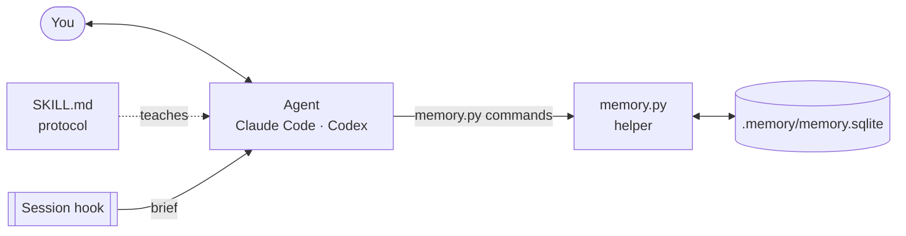

<div align="center">

# Long-Term Memory for AI

**A persistent, local, append-only memory for AI coding agents.**

[](https://github.com/howware/long-term-memory-for-AI/actions/workflows/tests.yml)
[](LICENSE)
[](https://www.python.org/)
[](CHANGELOG.md)

**English** · [Español](README.es.md) · [Website](https://howware.org/long-term-memory-for-AI/)

</div>

---

Long-Term Memory for AI gives coding agents such as **Claude Code** and **Codex** a memory that
survives across conversations. It lives in a single SQLite file inside each project. A new chat
window, with no context at all, starts from what was decided, what is pending and what happened,
instead of rebuilding it from old conversations or from Markdown notes.

## Contents

- [Why](#why)
- [Features](#features)
- [How it works](#how-it-works)
- [Requirements](#requirements)
- [Installation](#installation)
- [Project setup](#project-setup)
- [Usage](#usage)
- [Your data](#your-data)
- [Limitations](#limitations)
- [Configuration](#configuration)
- [Development](#development)
- [License](#license)

## Why

| Without a memory | With Long-Term Memory for AI |
|---|---|
| Every chat starts blank | Every chat starts with a brief of what is in force |
| Compaction loses exact words, dates and authors | Literal sources are kept as evidence, with their author |
| Notes files drift and contradict themselves | Facts have a validity period; changes close or retract, never overwrite |
| "How many?", "since when?" need guesswork | `aggregate`, `list` and `--as-of` answer from the records |
| A wrong memory cannot be traced | Every record names its source and the actor behind it |

## Features

- **Generic model, no domain tables.** Entities, facts over time, events with attributes and
  links, and observations describe any domain: a software project, a service desk, a hotel, a
  book in revision.
- **Append-only.** Database triggers prevent deleting or editing data. Facts are closed,
  superseded or retracted with a reason; events are voided; entities are renamed or retired. Any
  earlier state can be read again with `--as-of`.
- **Evidence and actors.** Each record keeps the literal text it came from and who or what
  produced it: a person, an agent, a system, a sensor. Decisions always belong to a person.
- **Questions without SQL.** Totals and rankings (`aggregate`), row listings (`list`), query paths
  across relations, `first(A | B)` to let one path override another, measures through any path,
  derived states (status rules), saved recipes, full-text `recall`, and pending actions per person
  or role. `--as-of` reads every fact as it was in force at any instant.
- **Versioned processes.** Workflows with roles, requirements, exceptions with a reason, deadlines
  and explicit migrations; running cases keep the version they started with.
- **Structured documents.** Texts versioned paragraph by paragraph and grouped in work sessions
  (`outline`, `history`, `changeset`).
- **Safe upgrades.** Schema changes ship as migrations: additive ones apply on open,
  transformative ones back up first, and every change is recorded.
- **Two agents, one memory.** Claude Code and Codex share the same file through the same helper.
- **No dependencies.** Python 3.9+ standard library only. No server, no network, no account.

## How it works



1. **At session start** a hook injects the brief: owner, project, decisions in force,
   conventions, open questions, lessons, pending actions and the latest records.
2. **While you work** the agent looks things up with the helper instead of guessing, and records
   decisions, answers, lessons, facts and events with your words as evidence.
3. **Next session**, in any agent, starts from the same memory.

Everything stored is in English so any agent can read it; your literal words are kept in their
original language, and the agent answers in the language you use.

## Requirements

- **Python 3.9 or newer**, available to the agent as `python`.
- **SQLite with FTS5**, included in the python.org, Homebrew, uv and most Linux builds.
- **Optional, Windows only:** `pip install tzdata` to use named time zones such as
  `America/Mexico_City`. Without it the system zone, `UTC` and fixed offsets (`-06:00`) work.

## Installation

Clone the repository and install the skill once per machine:

```bash
git clone https://github.com/howware/long-term-memory-for-AI.git
cd long-term-memory-for-AI
python tools/install_skill.py --target ~/.claude/skills/project-memory   # Claude Code
python tools/install_skill.py --target ~/.codex/skills/project-memory    # Codex
```

The installed skill is self-contained: `SKILL.md` (the protocol the agent follows) and `scripts/`
(the helper, its `memkit` package and the migrations). To update, pull the repository and run the
same commands again. Installing never touches an existing memory.

## Project setup

**1. Instructions.** Add to the project's `CLAUDE.md` (Claude Code) or `AGENTS.md` (Codex):

```markdown
## Persistent memory

This project uses the `project-memory` skill. At the start of every
conversation run `brief` and follow the cold start before answering. The
SQLite memory is the source of truth: do not rebuild from the chat history
what can be looked up there, and do not use Markdown files as memory.
```

**2. Hooks (Claude Code).** Merge into `<project>/.claude/settings.json`:

```json
{
  "hooks": {
    "SessionStart": [{
      "matcher": "startup|resume|clear|compact",
      "hooks": [{"type": "command", "timeout": 30,
                 "command": "python ~/.claude/skills/project-memory/scripts/memory.py brief --format hook"}]
    }],
    "UserPromptSubmit": [{
      "hooks": [{"type": "command", "timeout": 10,
                 "command": "python ~/.claude/skills/project-memory/scripts/memory.py reminder"}]
    }]
  }
}
```

Hooks load when a session starts, so open a new session after adding them. Both commands always
exit with code 0 and never block a session. Codex has no hooks; the instruction above does that
job.

**3. First chat.** The agent sees there is no memory yet, asks for your name and a key such as
`person:ana` (it never invents them) and creates `.memory/memory.sqlite`, which comes with its own
`.gitignore`. From then on, every chat starts with the brief.

## Usage

You talk to the agent; the agent drives the helper. For reference
(`MEM` = `python ~/.claude/skills/project-memory/scripts/memory.py`):

| Purpose | Command |
|---|---|
| Start of session | `MEM brief --format text` · `MEM catalog` |
| Find and understand | `MEM search "<text>"` · `MEM describe <ref>` · `MEM timeline <ref>` · `MEM recall "<words>"` |
| Remember a decision, convention, question, lesson… | `MEM remember --kind decision --text "…" --why "…"` |
| Record anything, atomically | `MEM write --file document.json` |
| Totals, rankings and rows | `MEM aggregate …` · `MEM list …` |
| What waits on someone | `MEM pending [--person <ref>]` |
| Keep an imported or high-volume event type out of the brief's recent list | `MEM define-event-type --type <type> --high-volume --by person:<id>` |
| Documents and versions | `MEM outline <root>` · `MEM history <ref>` · `MEM changeset <session>` |
| Versioned processes | `MEM define-process` · `MEM start-process` · `MEM advance` · `MEM process-status` |
| Backup | `MEM backup [--to <file or folder>]` |
| Help and version | `MEM --help` · `MEM <command> --help` · `MEM --version` |

Money and other exact quantities are stored as integers in their smallest unit (cents), with the
unit declared on the predicate, so sums are exact; the agent converts when presenting.

[`skill/project-memory/SKILL.md`](skill/project-memory/SKILL.md) is the complete reference: the
JSON document format, query paths, status rules, recipes, processes, actors, documents, high-volume
event types, money and re-imports.

## Your data

- **Local and private.** The memory is a file in your project. The helper makes no network calls.
  `.memory/` is excluded from Git by its own `.gitignore`; do not commit it.
- **Back it up.** It is one file and the only copy. `MEM backup` makes a verified copy with
  SQLite's online backup (safe while agents are writing) in `.memory/backups/` or wherever you
  say, and the brief shows the date of the last one. Copying the file by hand while it is open can
  miss recent writes.
- **Restore.** Close every agent session, replace `.memory/memory.sqlite` with the copy and
  delete `memory.sqlite-wal` and `memory.sqlite-shm` if present.
- **Upgrades.** A new version of the skill may bring migrations. Additive ones apply when the
  memory opens; a transformative one waits for `MEM init`, which backs the memory up first. A
  helper older than the memory opens it read-only.
- **Boundaries.** Recording or suggesting something never authorizes the agent to send messages,
  change external systems or make payments.

## Limitations

- **One machine, one project.** No sync, no server, no sharing between people or computers; it
  does not reach claude.ai in the browser.
- **It is as good as what gets recorded.** The agent may miss or misrecord things; evidence and
  history make that visible and correctable.
- **Nothing can be erased.** Being append-only, sensitive values can only be corrected or
  retracted. Do not store secrets or data you may be required to delete.
- **Not encrypted.** Anyone who can read the project folder can read the memory.
- **Keyword search.** `recall` uses SQLite full-text search with singular/plural matching, not
  semantic embeddings.
- **Context cost.** The brief (the latest 8 items per section, typically a few thousand tokens) is
  injected at every session start. High-volume event types (imports, readings) are summarized in
  one line per type instead of filling it.
- **A few writers.** SQLite serializes concurrent writes; it is not a multi-user server.
- **Early version.** Commands and schema may evolve; upgrades migrate existing memories.

## Configuration

| Variable | Effect |
|---|---|
| `MEMORY_DB` | Path of the memory, instead of the automatic search |
| `MEMORY_TZ` | Display zone: IANA name, `UTC` or a fixed offset. Default: the system's. Storage is always UTC |
| `MEMORY_AGENT` | Key of the agent that records (`agent:<name>`); Claude Code is detected |

Without `--db` or `MEMORY_DB`, the helper uses the nearest `.memory/memory.sqlite` between the
working directory and the project root (the folder with `.git`), so it never reads another
project's memory.

## Development

```bash
python -m unittest discover -s tests -v
```

| Path | Contents |
|---|---|
| `db/memory.py` | Entry point of the helper |
| `db/memkit/` | The helper's code, one module per topic |
| `db/migrations/` | Schema migrations; each declares `-- kind: additive` or `-- kind: transformative` |
| `skill/project-memory/SKILL.md` | The protocol agents follow |
| `tools/install_skill.py` | Installs the skill with the helper and migrations |
| `tests/` | Unit and acceptance tests |
| `docs/` | The project website (GitHub Pages) |

Issues and pull requests are welcome. Please run the tests before submitting a change, keep the
model generic (no domain tables) and keep the memory append-only.

## License

Licensed under the [Apache License, Version 2.0](LICENSE).
